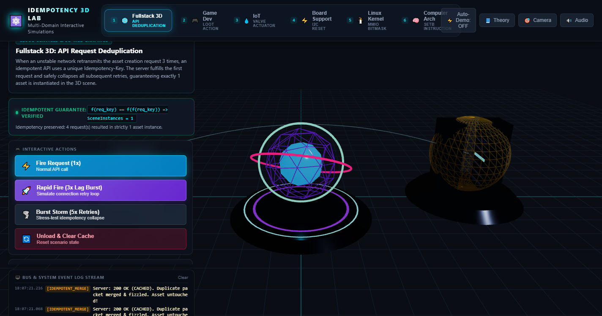
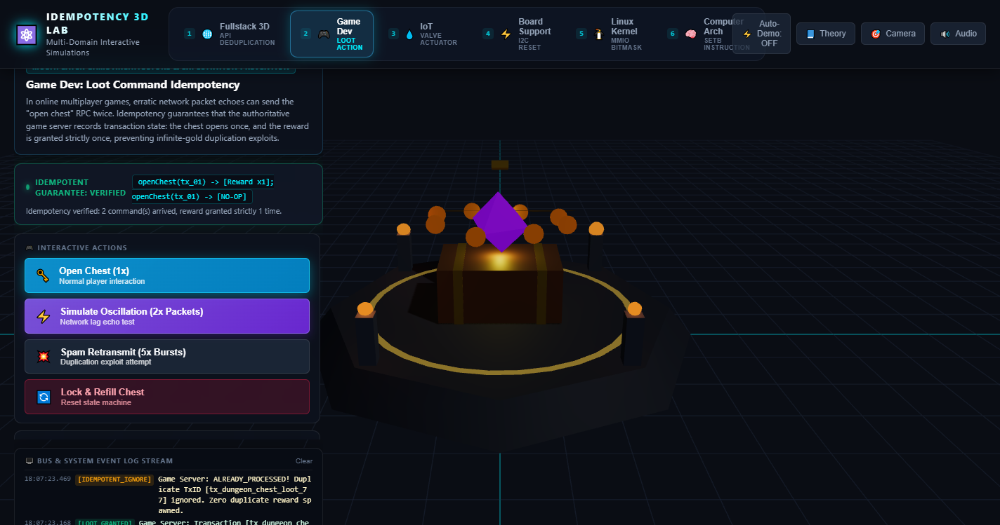
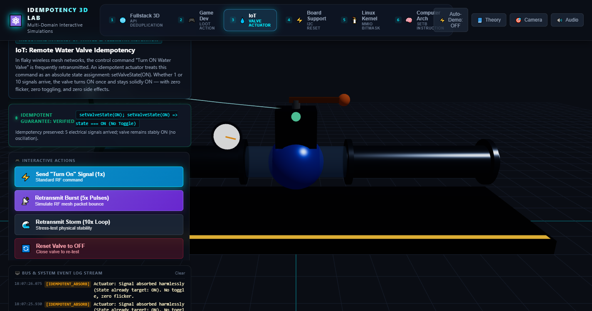
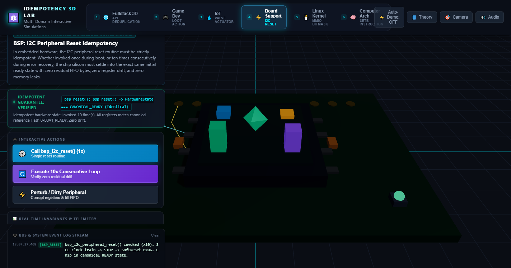
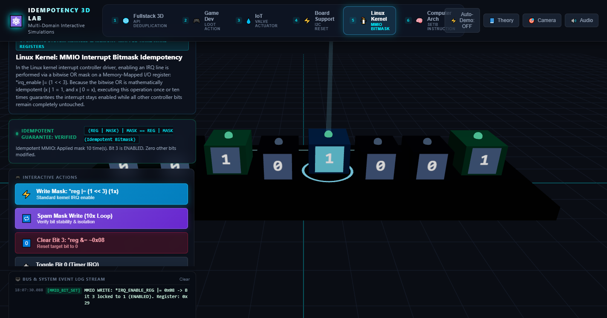
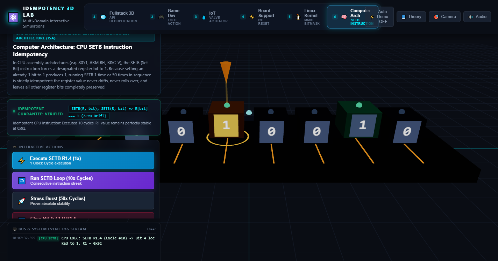

# Idempotency in 3D: Multi-Domain Interactive Simulations

A fullstack 3D single-page web application visualizing the fundamental computer science principle of **Idempotency** ($f(f(x)) = f(x)$) across six distinct layers of the computing hierarchy.

Built using **TypeScript** and **Three.js** loaded natively via **ES Modules** from a CDN using a browser `<script type="importmap">` — zero build tools, no Vite, no bundlers. Static files are served and run as-is.

---

## 🌟 The Core Principle: Idempotency

> **Idempotency** is the algebraic and operational property guaranteeing that applying an operation once or multiple times in sequence yields the exact same final state:
>
> $$\forall x, \quad f(f(x)) = f(x)$$
>
> In networked systems, distributed architectures, and hardware interfaces, communication channels are inherently unreliable. Packets drop, timeouts trigger retry storms, and connections oscillate. An idempotent design guarantees that network retransmissions produce **zero duplicate side effects**, **zero state corruption**, and **zero memory leaks**.

---

## 📸 The 6 Interactive Simulations (Visual Showcase & Mechanics)

---

### 1. 🌐 Fullstack 3D: API Request Deduplication



- **Domain:** Cloud Web Services & WebGL 3D Graphics
- **Scenario:** An API request to load a specific 3D asset that, even if fired three times in rapid succession due to network lag/retries, results in **strictly one asset instantiated in the scene**.
- **3D Visual Mechanics:**
  - A holographic Client Terminal on the left dispatches glowing cyan cyber-request packets bearing a unique header (`Idempotency-Key: req_quantum_core_9801`) along a curved quadratic network highway.
  - The API Gateway Server evaluates incoming packets:
    - **Packet 1 (Cache Miss):** Server fulfills the request (`201 Created`), activates the central world pedestal, and dynamically constructs a magnificent procedural Quantum Core with rotating nested icosahedrons, floating energy rings, and a crystalline beacon.
    - **Packets 2 & 3 (Cache Hit):** The server detects the duplicate transaction key (`200 OK - Cached`). The duplicate packets visibly hit the server deduplication shield and fizzle out into amber dissipation particles.
- **Idempotency Proof:** `Asset Instances in Scene = 1 (Unique)`, regardless of request burst volume.

---

### 2. 🎮 Game Dev: Authoritative Loot Command



- **Domain:** Multiplayer Game Architecture & Anti-Exploitation State Machines
- **Scenario:** A player's "open chest" command that, if sent twice due to connection oscillation, opens the chest **only once and does not duplicate the reward**.
- **3D Visual Mechanics:**
  - An ancient stone altar with glowing floor runes, burning corner stone lanterns, and a procedural treasure chest with wooden grain planks and golden bands.
  - When Command #1 arrives: The golden latch pops off, the lid physically hinges open backwards ($110^\circ$), volumetric golden light beams burst outward, and a single reward bundle spawns (1 spinning Mythic Soul Gem surrounded by 8 orbiting gold coins). Player inventory updates to $+500\text{ Gold}, +1\text{ Gem}$.
  - When Command #2 arrives (via connection oscillation): An authoritative server deflection barrier flares crimson around the chest. The server recognizes transaction ID `tx_dungeon_chest_loot_77` has already been fulfilled, deflecting the packet harmlessly.
- **Idempotency Proof:** `Reward Spawns Granted = 1x`, `Player Gold = 500` (Zero item duplication exploit).

---

### 3. 💧 IoT: Remote Water Valve Actuator



- **Domain:** Embedded Systems & Industrial Telemetry Actuation
- **Scenario:** A remote command to "turn on the water valve" that keeps the valve state as "on", **regardless of how many times the electrical signal is retransmitted**.
- **3D Visual Mechanics:**
  - An industrial pipeline assembly featuring an inflow pipe, motorized quarter-turn ball valve with servo motor housing, pressure dial gauge ($0\text{ to }65\text{ PSI}$), transparent fluid inspection chamber, and RF telemetry antenna with radiating radar waves.
  - Signal #1: Energizes the solenoid actuator (LED switches red $\rightarrow$ green) and rotates the valve handle $90.0^\circ$ parallel to the pipe. A high-density water droplet fluid particle vortex gushes through the transparent chamber, and the pressure needle sweeps to nominal pressure.
  - Retransmission Burst (5x / 10x): Repeated electrical signal pulses travel down the conduit. The actuator verifies `current_state == target_state (ON)` and absorbs the signals with blue grounding arcs. The valve handle experiences **zero flicker, zero toggling, zero jitter, and zero water hammer side effects**.
- **Idempotency Proof:** `Valve Physical State = ON (90.0°)`, `State Transitions = 1`, `Flow Rate = 120 L/min (STABLE)`.

---

### 4. ⚡ Board Support Package: I2C Peripheral Reset



- **Domain:** Low-Level Firmware Drivers & Hardware Abstraction Layers (HAL)
- **Scenario:** The reset code of an I2C peripheral that, regardless of being called once or ten times in a row, leaves the hardware chip in **exactly the same initial ready state**.
- **3D Visual Mechanics:**
  - A precision PCB motherboard with ENIG gold test pads, bypass capacitors, SCL/SDA trace lines, and a QFP semiconductor package with a translucent silicon die.
  - Floating above the die are 4 internal hardware registers visualized as 3D holographic status towers (`CR0 Control`, `SR0 Status`, `FIFO Buffer Depth`, `FSM State`) alongside a central emerald reference core.
  - Calling `bsp_i2c_peripheral_reset()` 1x or 10x replays the canonical clock recovery train (9 clock pulses on SCL $\rightarrow$ STOP $\rightarrow$ Soft-Reset `0x06`). A green planar scan-wave sweeps across the die: register towers snap to baseline, and the central core locks into a harmonic emerald resonance.
- **Idempotency Proof:** `State Consistency Hash = 0x00A1_READY (100% Match)`, `Residual Drift = 0.00%`.

---

### 5. 🐧 Linux Kernel: MMIO Interrupt Register Bitmask



- **Domain:** Kernel Internals & Memory-Mapped I/O (MMIO) Registers
- **Scenario:** Writing the enable bit in an interrupt register (Memory-Mapped I/O), where applying the bitmask consecutive times **keeps the interrupt enabled without altering other states of the controller**.
- **3D Visual Mechanics:**
  - A 3D bank of 8 bistable mechanical register cells representing an interrupt controller register (`*IRQ_ENABLE_REG` at address `0xFFFF_0204`).
  - Target bit is Bit 3 (`ETH_RX_IRQ`, mask `0x08 = 1 << 3`). Other bits represent active kernel drivers (Bit 0: Timer, Bit 5: NVMe).
  - When the kernel driver executes `*reg |= (1 << 3)`, an overhead MMIO laser beam focuses onto Bit 3, elevating the cell and locking it to `1` with a neon green aura.
  - Executing consecutively (10x): The bitwise OR operation $(R \mid M) \mid M = R \mid M$ ensures Bit 3 stays locked at 1, while bits 0, 1, 2, 4, 5, 6, and 7 remain completely untouched.
- **Idempotency Proof:** `Target Bit 3 = 1 (ENABLED)`, `Other Bits Altered = 0 (Strict Bit Isolation)`.

---

### 6. 🧠 Computer Architecture: CPU SETB Instruction



- **Domain:** CPU Microarchitecture & Assembly Instruction Set Architecture (ISA)
- **Scenario:** The CPU instruction `SETB` (Set Bit) in Assembly, which forces a specific bit of a register to the value 1, **keeping the same final result no matter how many times the instruction is executed in sequence**.
- **3D Visual Mechanics:**
  - A CPU execution pipeline with an Instruction Register (`SETB R1.4`, opcode `0xD2 0x94`), ALU write needle, and 8-bit General Purpose Register `R1`. Target is Bit 4.
  - Running `SETB` triggers a clock pulse: the ALU needle strikes Bit 4, which snaps to 1 with an energetic mechanical flip.
  - Running 10 or 50 cycles in sequence: The instruction pipeline decodes and executes continuously, but Bit 4 remains solidly at 1. The register value never rolls over, never increments, and never drifts.
  - **Contrast Mode:** A dedicated button demonstrates the non-idempotent instruction `CPL R1.4` (Complement/Toggle), allowing students to observe how non-idempotent operations oscillate ($1 \rightarrow 0 \rightarrow 1 \rightarrow 0$).
- **Idempotency Proof:** `Register R1 = 0x92 (Identical after 1x or 50x cycles)`, `f(f(R)) == f(R) -> TRUE`.

---

## 🎓 Teaching Idempotency: A Professor's Masterclass for a Virtual Audience

*The following guide is written in the pedagogical voice of a Computer Science professor conducting a live interactive webinar or virtual lecture using this 3D simulation suite.*

---

### Phase 1: The Intuitive Hook — The Elevator Button Paradox

> *"Good morning, everyone! Look at your screen. Before we write a single line of code or look at circuit diagrams, let me ask you a question in the chat:*
>
> *When you're waiting for an elevator in a hurry, what do you do? You press the 'Call Elevator' button. Then 3 seconds pass... and you press it again. And again. And again.*
>
> *Does the elevator arrive five times faster? Does the building dispatch five separate elevator cabins to your floor? Of course not! The first press requests the elevator; every subsequent press is harmlessly absorbed. The system's state remains: **ELEVATOR_SUMMONED**.*
>
> *In computer science and mathematics, we give this property a sacred name: **Idempotency**."*

---

### Phase 2: The Mathematical Foundation

> *"Mathematically, a function $f$ is idempotent if applying it twice gives the exact same result as applying it once:*
>
> $$f(f(x)) = f(x)$$
>
> *You've known idempotent operations since grade school!*
> 1. *The Absolute Value: $| |-5| | = |5| = 5$.*
> 2. *Geometric Projections: Projecting a 3D shadow onto the floor: once the shadow is on the floor, projecting it onto the floor again changes nothing.*
> 3. *Set Union: $A \cup A = A$.*
>
> *Now, why is this concept the difference between a resilient system and a catastrophic outage? Let's take a journey down the entire computing hierarchy using our 3D interactive laboratory."*

---

### Phase 3: Tour of the 6 Computing Tiers (Interactive Demonstration)

#### 1. High-Level Web & Cloud: "The Double Charge Nightmare"
> *"Look at Tab 1. In web development, network lag is inevitable. A customer clicks 'Buy Ticket'. A packet drops. The browser automatically retries 3 times. If your API is **non-idempotent**, the user's credit card gets charged 3 times and 3 seats are booked!*
>
> *Watch what happens when I click 'Rapid Fire 3x' in Tab 1: 3 request packets fly across the cyber-highway. The server receives the first, issues a `201 Created`, and instantiates our 3D Quantum Core. Look closely at packets 2 and 3: they carry the same `Idempotency-Key`. The server recognizes them, flashes amber, and merges them away. Result? Exactly 1 asset instance in the scene. Zero duplication."*

#### 2. Game Engineering: "The Infinite Duplication Exploit"
> *"Let's switch to Tab 2. In online games, players face connection jitter. Imagine a player opening a dungeon treasure chest. If the network rebounds the 'open_chest' RPC twice, what happens without idempotency?*
>
> *The chest opens twice, and the player gets double the loot! That's the recipe for hyper-inflation and economy-breaking exploits. Watch our 3D chest: on the second packet arrival, our authoritative game server displays `ALREADY PROCESSED`. The duplicate packet bounces off a protective force field. The reward spawns emphatically once: 500 gold, never 1,000."*

#### 3. Cyber-Physical IoT: "The Danger of Toggling"
> *"Switching to Tab 3: Here we enter the physical world. Notice our industrial motorized water valve. A command arrives: 'Turn Valve ON'.*
>
> *What if the programmer had implemented this as `toggleValve()` instead of an absolute state assignment `setValveState(ON)`?*
>
> *If a wireless LoRa or Zigbee mesh retransmits the signal 5 times, a toggle command would flip the valve: Open $\rightarrow$ Closed $\rightarrow$ Open $\rightarrow$ Closed $\rightarrow$ Open! The physical motor would burn out, and pipe pressure would cause catastrophic water hammer.*
>
> *Notice our simulation: as I fire a burst of 5 retransmissions, repeated electrical pulses reach the actuator terminal and are grounded harmlessly. The valve stays locked at $90.0^\circ$ and the fluid stream remains perfectly laminar."*

#### 4. Board Support Package: "Deterministic Hardware Recovery"
> *"Now let's go deeper into low-level firmware in Tab 4. When an I2C sensor bus hangs due to electrical noise, the BSP recovery routine must reset the peripheral.*
>
> *Whether the reset routine runs once on boot or loops ten times during a brownout recovery, the hardware chip silicon must land in the exact same initial ready state. Notice our 4 holographic register pillars: regardless of 1x or 10x calls, the register towers settle into identical heights, and the state hash matches `0x00A1_READY` with $0.00\%$ residual drift."*

#### 5. Operating System Kernel: "Bitmask Isolation in MMIO"
> *"In Tab 5, we are inside the Linux Kernel driver for an interrupt controller. When the Ethernet driver wants to enable its receive interrupt, it performs a bitwise OR operation on a hardware register: `*irq_enable |= (1 << 3)`.*
>
> *Because bitwise OR is idempotent ($x \mid 1 = 1$, and $x \mid 0 = x$), the kernel can execute this mask write ten times consecutively without lockouts. Watch the focused laser beam: Bit 3 locks to 1, while every other system interrupt—timer, storage, DMA—remains completely undisturbed."*

#### 6. Silicon Microarchitecture: "Bistable Latches in the CPU"
> *"Finally, Tab 6: We are on the CPU die. The assembly instruction `SETB R1.4` tells the ALU to force bit 4 of Register 1 to 1.*
>
> *Watch the CPU clock pulse through the interconnect lines: Bit 4 flips to 1. Now I click 'Run 50x Cycles'. The CPU pipeline churns, but the register value remains rock-solid at `0x92`. No arithmetic overflow, no accumulator drift.*
>
> *And now, class, for the ultimate contrast: click 'Contrast: CPL' (Complement/Toggle). Watch Bit 4 violently oscillate between 1 and 0 on every tick. That oscillation is the chaos of non-idempotency; `SETB` is the calm certainty of idempotency."*

---

### Phase 4: Key Takeaway Summary for Students

| Tier | Non-Idempotent Implementation | Idempotent Implementation | Real-World Consequence |
| :--- | :--- | :--- | :--- |
| **Cloud / Web** | `POST /orders` (no token) | `POST /orders` (`Idempotency-Key: uuid`) | Prevents duplicate bank charges & double bookings |
| **Game Dev** | `grantReward()` on message | Track `transaction_id` in player state | Prevents economy-breaking duplication exploits |
| **IoT / Physical** | `toggleActuator()` | `setActuatorState(TARGET_STATE)` | Prevents motor burnout and mechanical chatter |
| **Firmware / BSP** | Cumulative reset script | Canonical baseline reset sequence | Prevents register drift and uncalibrated sensor states |
| **OS Kernel** | Overwriting whole registers | Bitwise mask (`*reg \|= (1 << bit)`) | Guarantees isolated hardware interrupt control |
| **CPU Architecture**| Toggling flip-flop (`CPL`) | Absolute bit latching (`SETB`) | Guarantees deterministic microcode execution |

---

## 🏃 Running the Application Locally

The application consists of static files served without any build pipeline:

```bash
# Option 1: Built-in Python static server
python -m http.server 8080

# Option 2: Node / npm
npm run serve
```

Open **[http://localhost:8080](http://localhost:8080)** in any modern web browser.

### Interactive Hotkeys
- **`1` – `6`**: Jump directly between the 6 simulation domains
- **`Spacebar`**: Trigger the primary action of the active simulation
- **`R`**: Re-center 3D orbit camera
- **`⚡ Auto-Demo`**: Toggle continuous autonomous demonstration loop
- **`📘 Theory`**: Open the in-app architectural guide modal
- **`🔊 Audio`**: Toggle synthesized Web Audio sound FX
